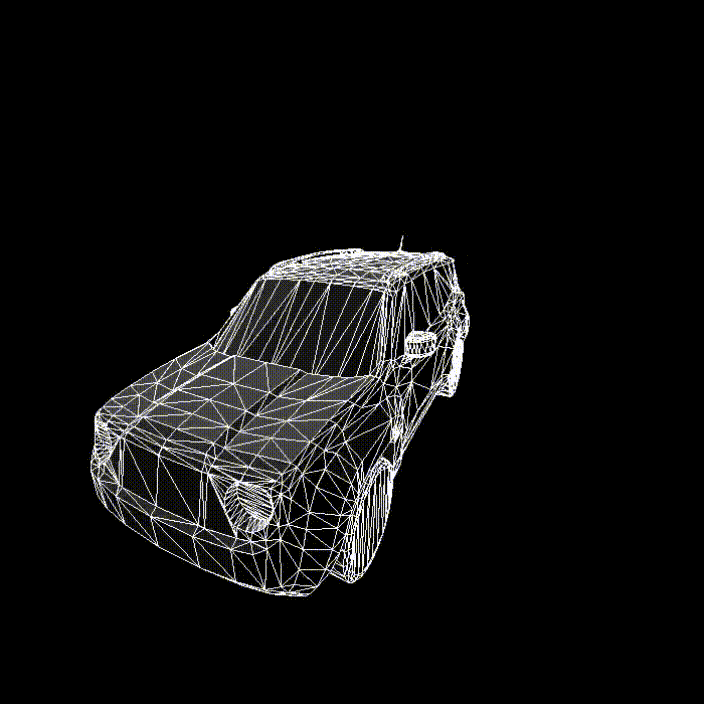

# 3D Renderer

A 3D rendering engine built from scratch in C++.

I made this project to understand the fundamentals of 3D graphics (including it's mathematics)

## Features

- **3D transformations**: vector and matrix operations for manipulating objects in 3D space.
- **Perspective projection**: transforms 3D coordinates into screen-space coordinates using a projection matrix.
- **Camera system**: controls the viewpoint and orientation of the scene in real-time using keyboard.
- **Triangle clipping**: clips meshes against the viewing frustum before rendering.
- **OBJ model loading**: loads 3D meshes, including vertex positions, texture coordinates, and normals
- **Lighting**: ability to have multiple light sources and calculate shadows (does not work with textures yet)
- **Texture mapping**: supports texture coordinates for mapping images onto 3D geometry (very bugy).

## Demo

<table>
  <tr>
    <td align="center" width="50%">
      <strong>Jeep_Renegade_2016</strong>
    </td>
    <td align="center" width="50%">
      <strong>utah_teapot_2026</strong>
    </td>
  </tr>
  <tr>
    <td align="center">
      
    </td>
    <td align="center">
      
    </td>
  </tr>
</table>


## Prerequisites

- A C++ compiler.
- CMake 3.24 or newer.
- SDL3 libraries.

## Build

Clone the repository:

```bash
git clone https://github.com/Kaed-Blue/3D_Renderer.git
cd 3D_Renderer
```

make a src diractory and add your sdl3 include and lib files inside it

Configure the project:

```bash
cmake -S . -B build
```

add the SDL3.dll file in the build diractory

Build the executable:

```bash
cmake --build build
```

Run the generated executable from the build directory.
